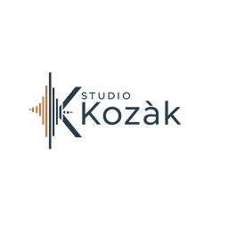
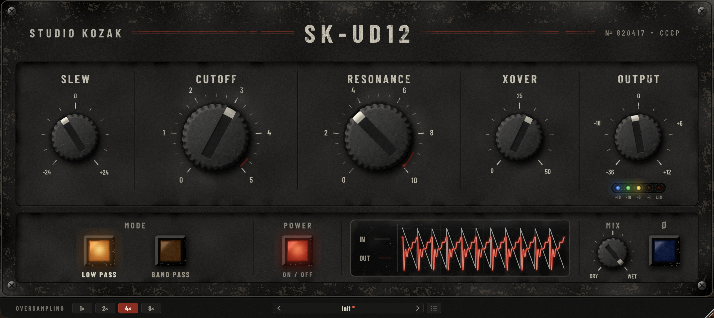
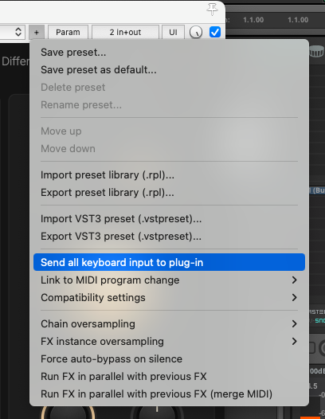

<p align="center">
  
</p>

<h1 align="center">SK-UD12</h1>

<p align="center">
  <em>Bob Moog knew how to build legendary filters. Vladimir Kuzmin was not far behind.</em>
</p>

<p align="center">
  
</p>

<p align="center">
  <strong>
    <a href="https://github.com/studiokozak/SK-UD12/releases/latest">
      Download Latest Release
    </a>
  </strong>
</p>

---

## Overview - In memory of Vladimir Kuzmin

In the early 1980s, the Soviet Union gave birth to a legendary synthesizer with a voice like no other. At its heart was a filter designed by Vladimir Kuzmin, built from very few components, and famous ever since for its raw, aggressive and slightly untamed character.
SK-UD12 tries to recreate that filter by modeling its original circuit. Its name comes from the component that turned this filter into a legend.
Vladimir Kuzmin left us in June 2026, and his immense talent will always be sorely missed.
With very little, he created an instrument that has inspired musicians all over the world for more than forty years. SK-UD12 is a humble attempt to bring his work back to life, and above all a tribute to a great engineer for whom I have immense respect.

Thank you so much, Mr. Kuzmin. Rest in peace.

---

## Features

* Modeled from the schematics of the original circuit
* Low Pass and Band Pass modes, as on the original
* Resonance up to self-oscillation
* SLEW: drives the circuit into its limits, at constant output level
* XOVER: crossover distortion, for grit and broken textures
* Dry/Wet mix with polarity switch for parallel filtering
* Built-in oscilloscope
* Output level LEDs and safety limit: the output never goes above 0 dBFS
* Oversampling: 1×, 2×, 4×, 8×
* Built-in preset manager with folders
* Resizable interface
* Mono and stereo
* VST3 (Windows & macOS)
* Audio Unit (macOS)
* Intel & Apple Silicon support

---

## Controls

The upper row of knobs follows the path of your sound through the filter, from left to right: how hard it hits the circuit, how the filter shapes it, how the output stage colors it, and how loud it comes out. The lower row is where you choose the mode, watch what happens and blend the filter with your dry sound.

CUTOFF, RESONANCE and MODE come from the original machine. The other controls were added to make the filter easier to use in a mix.

Every knob works the same way: drag up or down, hold Shift for fine adjustments, or use the mouse wheel. Double-click a knob to bring it back to its default value. The value appears while you turn it and fades out when you let go.

---

### THE FILTER

#### SLEW

SLEW sets how hard your sound hits the circuit, and the bubble shows it in decibels and in volts. It is not a volume knob: the output level stays the same whatever you do.
As you turn it up, the two amplifiers inside the filter struggle more and more to follow your sound. The resonance gets tamed and compressed, the transients become rounder and the sound thickens. Turn it down and the filter opens up again, cleaner and more resonant.
SLEW changes the way the filter behaves rather than adding distortion. For grit, look at XOVER.

#### CUTOFF

CUTOFF sets the frequency of the filter, on the same 0 to 5 scale as the original panel.
The small red mark near the end of the travel shows where the original circuit runs out of steam: beyond it, the cutoff hardly rises any more. That is how the original behaves, and SK-UD12 keeps it that way.

#### RESONANCE

RESONANCE emphasizes the frequencies around the cutoff, from 0 to 10.
The dark red arc marks the zone of strong resonance, and the bright red arc the point where the filter starts to oscillate on its own and sings even without any input. This is where the filter gets wild, and where it is the most fun.

#### XOVER

XOVER adds crossover distortion, the kind that appears in the output stage of the amplifiers, right where the signal crosses zero. It does not sound like the usual saturation: it is grainy, buzzy and a little broken, and it affects the quiet parts of the sound more than the loud ones.

#### SLEW and XOVER, two sides of the same coin

These two knobs are closely linked, so it is best to set them together.
XOVER acts on a fixed zone around zero, while SLEW decides how big your sound is when it reaches that zone. With SLEW down, your sound stays small compared to the crossover zone, and even a little XOVER makes it grainy and ragged, almost lo-fi. With SLEW up, your sound becomes much bigger than that zone, the crossover distortion fades into the background, and the amplifiers' own limits take over with a smooth, thick, compressed resonance.
So if XOVER seems too strong or too discreet, try moving SLEW first.

#### OUTPUT

OUTPUT sets the level of the filtered sound, from −36 to +12 dB, with 0 dB at noon. It does not affect the dry sound blended in with MIX.
The five LEDs below show the output level. The last one, LIM, lights up when the safety limit is working, so that SK-UD12 never goes above 0 dBFS, even in full self-oscillation.

---

### MODE

LOW PASS keeps everything below the cutoff, for the classic, fat sound of the original. BAND PASS keeps only a band around the cutoff, which sounds thinner and more nasal, and works wonders with a lot of resonance.

---

### POWER

POWER switches the filter ON or OFF. A short fade has been built in to avoid clicks.

---

### OSCILLOSCOPE

The screen shows your input in grey and your output in red, over about 25 milliseconds. You can literally watch the filter round off, ring and oscillate, which is a great way to understand what SLEW and XOVER are doing.

---

### MIX & POLARITY

#### MIX

MIX blends your dry sound with the filtered one, from DRY to WET, and is fully WET by default.
Parallel filtering lets you keep the weight and attack of the original sound while adding the growl of the filter on top. With a filter, however, blending is not only a matter of level, because of phase.

#### Ø and phase rotation

A filter does not only change the tone of a sound, it also shifts the frequencies around the cutoff slightly in time. This is called phase rotation. Below the cutoff, the filtered sound stays roughly aligned with the dry one, but around and above it, the two drift further and further apart.

The original circuit adds a twist of its own: its low pass output is inverted, and SK-UD12 keeps it that way. As a result, in LOW PASS mode with MIX halfway, the filtered and dry sounds work against each other, the lows cancel out and the sound becomes thin and hollow. The Ø button flips the polarity of the filtered sound back, so that both add up again in the lows.

In practice:

* **In LOW PASS, turn Ø on as soon as you use MIX.** The dry and filtered sounds add up, and the lows stay solid.
* **Then listen around the cutoff.** Because of phase rotation, the two sounds still interact there, especially with resonance. That interaction is part of the sound, so try both positions of Ø and keep the one you prefer.
* **BAND PASS behaves differently.** Its phase shift is not the same, so the blend sounds different again. Let your ears decide.
* **Fully WET, Ø makes no audible difference** on its own. It only matters if you blend SK-UD12 with another track.

The dry sound goes through exactly the same oversampling stages as the filtered one, so MIX never adds any coloration of its own.

---

### OVERSAMPLING

You will find OVERSAMPLING in the bottom bar, set to 4× by default.
Because this filter is a nonlinear circuit, it creates new frequencies as it works. Oversampling keeps them clean and free of digital artifacts. 4× suits most situations. Switch to 8× if you push SLEW and RESONANCE hard on bright material, and drop to 1× or 2× to save CPU when the filter stays gentle.

---

### Presets

The preset bar sits in the middle of the bottom bar. Use the arrows to step through your presets, or click the name to open the preset panel, where you can save, name, rename and delete your settings and sort them into folders. A red asterisk tells you when the current preset has been modified.
Loading a preset never clicks: SK-UD12 briefly fades to your dry sound while the new settings are applied.
POWER, OVERSAMPLING and OUTPUT are not stored in presets, because they belong to your session rather than to the sound.
There are no factory presets, only Init. Every source is different, and the right settings depend on yours.

**Reaper users:** by default, Reaper keeps keyboard shortcuts for itself. Press the space bar while naming a preset and your song starts playing instead of a space being typed. To fix this, click the + button at the top of the plugin window and enable Send all keyboard input to plug-in. Keep in mind that while this option is on and the plugin window has focus, the space bar will not start or stop playback, so you may want to switch it back off once your presets are named.

<p align="center">
  
</p>

---

### Window size

Drag the bottom right corner to resize the window. SK-UD12 remembers its size with your project.

---

## Philosophy

This filter was never meant to be polite. It was born from constraints, and its character comes from components pushed beyond what they were designed for.
SK-UD12 does not try to smooth that out. It gives you the circuit with its limits and its quirks, along with a few modern controls to help it find its place in a mix.
Start from Init, bring the cutoff down and push the resonance until it sings.
Then play with SLEW and XOVER together.
Blend it back with MIX, without forgetting Ø.
Listen.
Trust your ears.

---

## Typical Applications

SK-UD12 may work particularly well on:

* Synth basses and leads
* Clean or distorted guitars
* Pads and textures that need some teeth
* Vocals, for radio, lo-fi or downright aggressive effects
* Sound design, with the filter in self-oscillation

And, thanks to MIX and Ø, on anything that needs a growl without losing its weight.

---

## System Requirements

### Windows

* Windows 10 or later
* VST3 compatible host
* VST3 format

### macOS

* macOS 11 Big Sur or later
* Intel or Apple Silicon
* VST3 and Audio Unit (AU) formats
* Compatible VST3 or Audio Unit host

---

## Installation

### Windows

Copy:

`SK-UD12.vst3`

to:

`C:\Program Files\Common Files\VST3`

Then restart your DAW.

### macOS

#### VST3 Version

Copy:

`SK-UD12.vst3`

to:

`/Library/Audio/Plug-Ins/VST3`

#### Audio Unit Version

Copy:

`SK-UD12.component`

to:

`/Library/Audio/Plug-Ins/Components`

Then restart your DAW.

---

### macOS Security

SK-UD12 is built as a Universal Binary and supports both Intel and Apple Silicon Macs.
Depending on your macOS security settings, you may need to authorize the plugin manually the first time it is loaded, from System Settings > Privacy & Security.

If your DAW still refuses to load it, open Terminal and run:

```
xattr -dr com.apple.quarantine "/Library/Audio/Plug-Ins/VST3/SK-UD12.vst3"
xattr -dr com.apple.quarantine "/Library/Audio/Plug-Ins/Components/SK-UD12.component"
```

---

## Notes

SK-UD12 is neither a generic vintage filter nor a Moog-style ladder. It is one very specific circuit, with its own logic, its own flaws and its own voice.
This filter taught many musicians that a filter does not have to be clean to be beautiful. Hopefully, SK-UD12 keeps a little of that lesson alive.
With this plugin, I simply wanted to pay tribute to one of the greatest engineers of our time. I hope that, wherever he is now, Vladimir Kuzmin will go on inspiring many musicians.

---

Hope you enjoy SK-UD12.

*Stéphan (Studio Kozak)*
